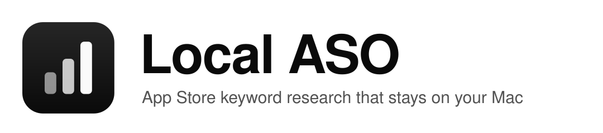
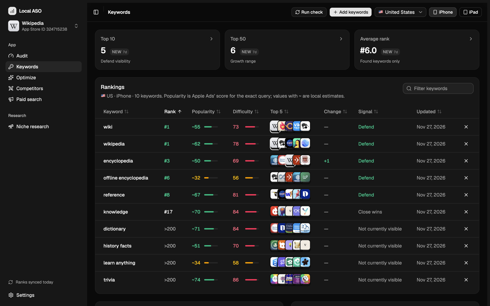
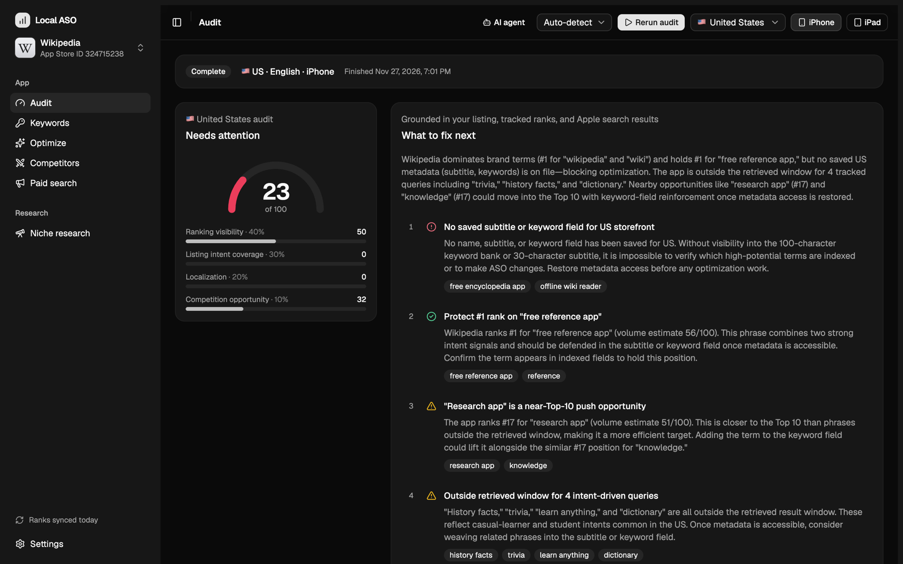
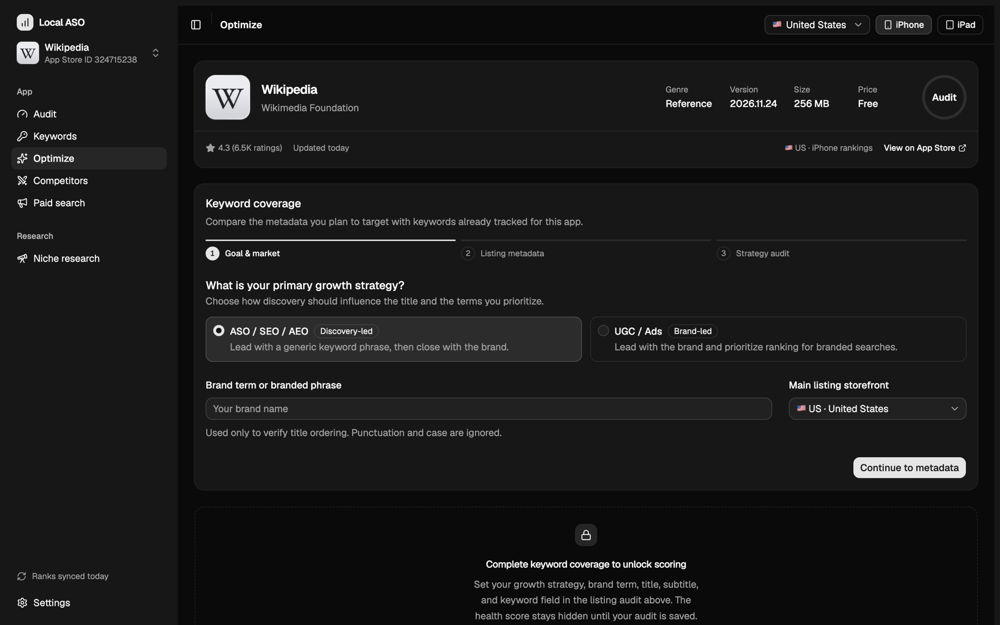
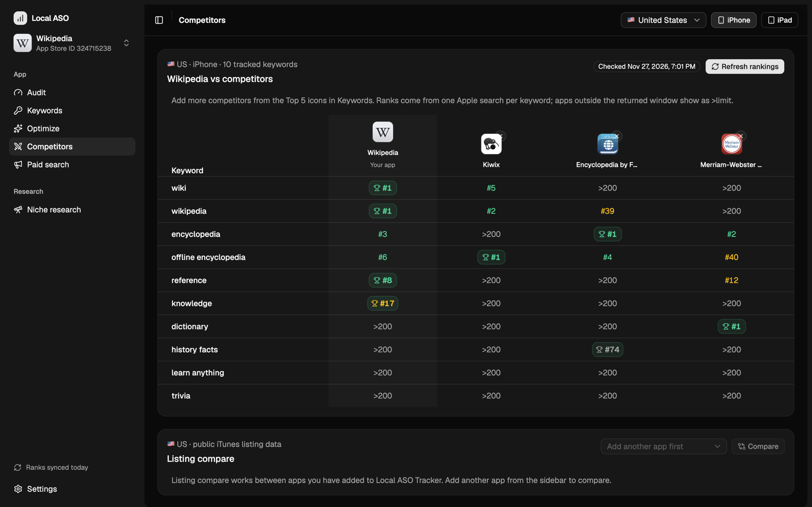
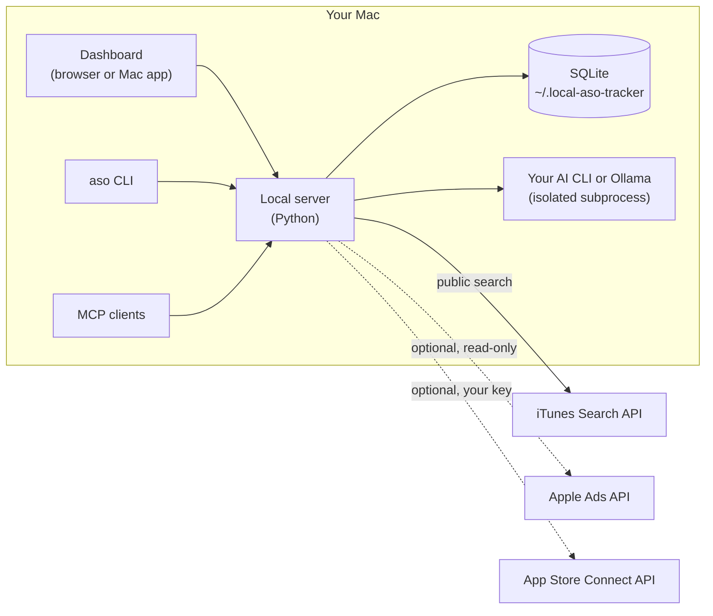

<p align="center">
  <picture>
    <source media="(prefers-color-scheme: dark)" srcset="docs/assets/logo-dark.svg">
    
  </picture>
</p>

<p align="center">
  <b>Track where your iPhone and iPad apps rank, find the keywords worth chasing, and localize your listing in 69 markets.</b><br>
  Everything runs on your Mac. No account, no cloud, no subscription. Free and open source.
</p>

<p align="center">
  <a href="LICENSE"></a>
  
  
  
  
  
</p>

<p align="center">
  <a href="#-key-features">Features</a> ·
  <a href="#-get-started">Get started</a> ·
  <a href="#-explore-local-aso">Tour</a> ·
  <a href="#-how-it-works">How it works</a> ·
  <a href="#%EF%B8%8F-cli--mcp">CLI &amp; MCP</a> ·
  <a href="docs/GUIDE.md">Full guide</a>
</p>

<p align="center">
  
</p>

<p align="center"><sub>Screenshots show a demo workspace tracking Wikipedia's public App Store listing with live data from Apple.</sub></p>

---

### 📰 What's new

- **v0.6.0** · The Mac app can now update itself and ships with signing and release tooling. Local AI tools run in isolation and fall back to the next one when a tool fails, with sign-in checks built in. Localized listings get a store-style preview, and untracked keywords can be tracked in one click.
- **Purchasing-power pricing**: suggested local prices for the app, in-app purchases and subscriptions in every territory, based on a bundled World Bank table.
- **69 native-language markets**: keyword research and listing localization in each market's own language. Gemini, OpenCode and Ollama join Claude and Codex as local AI options.
- **A native Mac app**: a redesigned dashboard built with shadcn/ui, packaged as a macOS app with Tauri.

## ✨ Key features

- 📈 **Rank tracking across countries and devices.** Daily ranks per keyword, per storefront, iPhone and iPad separately, plus history charts, 7- and 30-day trends, and the apps you're "losing to".
- 🔥 **Real Apple search popularity.** Connect Apple Ads (read-only) and the Popularity column shows Apple's own 5–100 score for each keyword. Without it, you get a clearly marked local estimate (`~`).
- 🧭 **AI app audits.** A 0–100 audit per storefront. Your local AI suggests keywords in the market's language, every suggestion is rank-checked against Apple, and an editor pass keeps only evidence-backed findings. Competitor brand names are listed separately as Apple Ads keywords.
- 🌍 **Localization in 69 markets.** Generate Name, Subtitle, Keyword field, Description, Promotional text and What's New for any locale. Each draft is audited against your strategy and can be previewed as a store page. Push approved locales to an editable App Store Connect version.
- 💸 **Purchasing-power pricing.** Apple's equalized price in each territory, scaled by the World Bank price level, then snapped to a real Apple price point. You review every change before anything is pushed.
- 🥊 **Competitor intelligence.** A keyword × app rank matrix, side-by-side public listing comparison, and the Top 5 results for every keyword shown with their App Store icons.
- 🔬 **Niche research.** Brainstorm keywords for an idea that isn't an app yet and check the field in several countries at once.
- 🤖 **Bring your own AI, locally.** Claude, Codex, Gemini or OpenCode CLIs, or a model in Ollama. Each runs isolated in an empty folder, with sign-in checks and automatic fallback. The app never calls an AI service itself.
- 🧩 **Agent-ready.** A built-in MCP server lets Claude, Codex or any MCP client read your rankings and add keywords.
- 📦 **Ship it your way.** Export to fastlane `deliver`, CSV/JSON, or a self-contained offline HTML report.

## 🆚 Why Local ASO

| | Typical hosted ASO tool | **Local ASO** |
|---|---|---|
| Price | Monthly subscription | **Free, MIT licensed** |
| Where your data lives | Their cloud | **SQLite on your Mac** |
| Account required | Yes | **No** |
| Search popularity | Estimated from third-party data | **Apple Ads' own score**, or a clearly marked estimate |
| AI | Their model, their prompts | **Your own CLI or local model** |
| App Store Connect keys | Uploaded to their servers | **Stay on your machine** and talk only to Apple |
| Honesty about ranks | Exact ranks extrapolated | **Apple's result window only**; beyond it reads `>200` |

## 🚀 Get started

<details open>
<summary><b>Run the dashboard (macOS, Windows, Linux)</b></summary>

You need Git and [`uv`](https://docs.astral.sh/uv/getting-started/installation/). Node isn't needed: the dashboard's built files are committed.

```bash
git clone https://github.com/GabrielRw/Local-ASO.git
cd Local-ASO
uv sync --locked
uv run aso dashboard
```

This opens [http://127.0.0.1:8765](http://127.0.0.1:8765). The setup guide asks for your App Store link, a few keywords and your preferred local AI, then runs the first rank check.
</details>

<details>
<summary><b>Build the Mac app</b></summary>

Needs uv, Node + pnpm, Rust and the Xcode command line tools.

```bash
./scripts/build-macos.sh
```

The app and DMG land in `desktop/src-tauri/target/release/bundle/`. It uses the same data folder as the CLI (`~/.local-aso-tracker`), checks GitHub for signed updates (optional), and shuts its local server down cleanly when you quit. Apple Silicon only for now.
</details>

<details>
<summary><b>Connect a local AI (optional)</b></summary>

Install and sign in to any of:

- the [Claude Code](https://docs.anthropic.com/en/docs/claude-code), Codex, Gemini or OpenCode CLI;
- [Ollama](https://ollama.com) with a model (`ollama pull llama3.1`).

Then open **Audit → AI agent**. Each tool shows its version, **Check** confirms it's signed in and answering, and **Sign in** opens Terminal with the right command. With Auto-detect, a tool that fails is skipped for the next one.
</details>

<details>
<summary><b>Connect Apple Ads and App Store Connect (optional)</b></summary>

- **Apple Ads** (read-only) adds Apple's real search popularity, your campaigns, bids, spend and keyword suggestions. See [Apple Ads reporting](docs/GUIDE.md#apple-ads-reporting).
- **App Store Connect** lets you push approved localized listings and price changes to an editable version. The `.p8` key stays on your Mac. See [App Store Connect API key](docs/GUIDE.md#app-store-connect-api-key).
</details>

## 📖 Explore Local ASO

<details open>
<summary><b>🧭 Audit: a 0–100 score per storefront, with evidence</b></summary>
<br>
<p align="center"></p>

Your local AI proposes keywords in the market's own language, a native-language review filters them, and every phrase is rank-checked against Apple before an editor pass writes the findings. Recommended keywords are sorted by opportunity and tracked in one click. **All markets** shows the latest audit for each storefront.
</details>

<details>
<summary><b>📈 Keywords: ranks, popularity, difficulty and the Top 5</b></summary>
<br>
<p align="center"></p>

Top 10, Top 50 and average-rank cards with trends, a sortable rankings table, per-keyword history, the overall rank trend and the competitors you're losing to. A missing app reads `>200`: Local ASO never invents a rank beyond Apple's result window.
</details>

<details>
<summary><b>🌍 Optimize: listing strategy, localization and pricing</b></summary>
<br>
<p align="center"></p>

- **Listing coverage:** pick your goal and brand term, then paste your name, subtitle and keyword field. Repeated and brand words are highlighted live, and the strategy score explains each point.
- **Localization studio:** generate, edit and preview each locale. Nothing reaches App Store Connect until you approve and push it.
- **Purchasing-power pricing:** review a suggested price for each territory before anything is pushed.
</details>

<details>
<summary><b>🥊 Competitors: who outranks you, keyword by keyword</b></summary>
<br>
<p align="center"></p>

Add any app from a Top 5 icon and compare ranks across your whole keyword set, alongside its public listing.
</details>

## 🧠 How it works



- **Apple only.** The server talks only to Apple. The Mac app's shell may also check GitHub for a signed update, and you can turn that off.
- **Honest numbers.** Apple doesn't publish search volume or downloads, so Local ASO doesn't invent them. Popularity is Apple Ads' score or a local estimate marked `~`. Ranks beyond Apple's result window read `>200`.
- **Your keys stay put.** App Store Connect and Apple Ads credentials are read locally and never shown in the browser, logged or exported.

## ⌨️ CLI & MCP

```bash
uv run aso apps add --name "My App" --apple-id 123456789
uv run aso keywords add "habit tracker"
uv run aso countries add fr
uv run aso track add --app-id 123456789 --keyword "habit tracker" --country fr
uv run aso check --only-missing-today
uv run aso rankings --country fr
uv run aso export fastlane --app-id 123456789 --output ./fastlane
uv run aso report --output report.html
```

While the dashboard runs, MCP clients can connect to `http://127.0.0.1:8766/mcp`. Tools include `get_keyword_rankings`, `get_app_summary`, `get_listing_coverage`, `add_keywords` and `run_checks`. See [Local MCP server](docs/GUIDE.md#local-mcp-server).

## 📚 Documentation

The **[full guide](docs/GUIDE.md)** covers:

- the dashboard, step by step;
- niche research;
- audits;
- localization;
- pricing;
- Apple Ads;
- the CLI reference;
- storage, scheduling, backups and troubleshooting;
- development;
- building and releasing the Mac app.

## 🗺️ Roadmap

- [x] Rank tracking, history, competitors, niche research
- [x] AI audits and localization in 69 markets
- [x] Apple Ads popularity, purchasing-power pricing, fastlane export
- [x] Native Mac app with signed auto-updates
- [ ] Signed and notarized public releases
- [ ] Windows build
- [ ] Google Play support

## 🤝 Contributing

Issues and pull requests are welcome. Read [AGENTS.md](AGENTS.md) for the project's rules (local-only, no invented metrics) and run the checks listed there before opening a PR. The [development section](docs/GUIDE.md#development) explains the setup.

## 📄 License

[MIT](LICENSE). Not affiliated with Apple. App Store, Apple Ads and App Store Connect are trademarks of Apple Inc.
